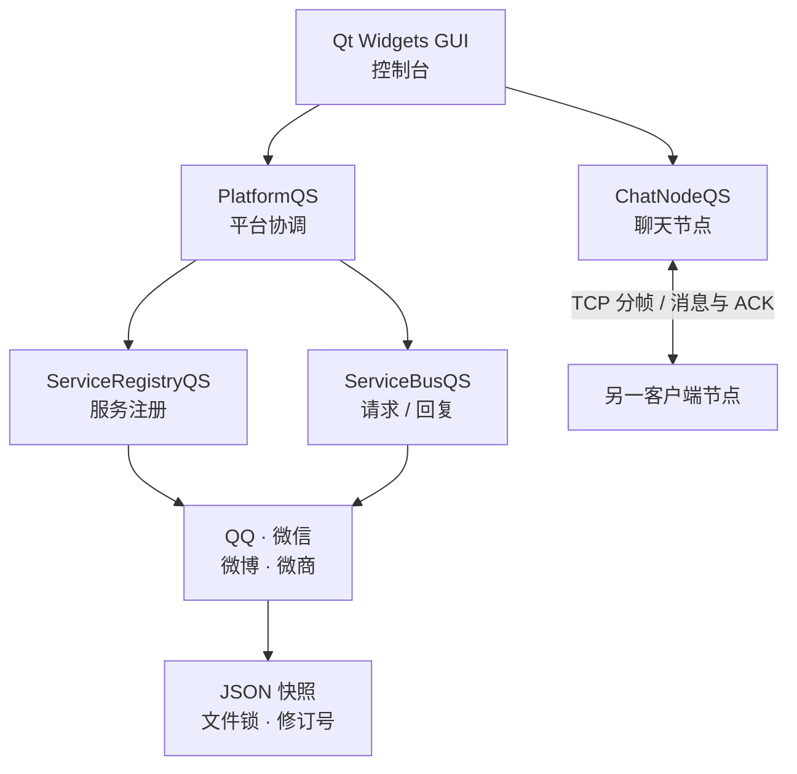

<a id="top"></a>

<div align="center">


# 同窗 QS · TongChuangQS

**以服务为核心的 C++ 社交模拟系统**

四种社交服务 · 图形与控制台双入口 · 本地数据持久化 · TCP 双窗口聊天

<p>
  
  
  
  
</p>

[功能概览](#features) · [快速开始](#quick-start) · [架构设计](#architecture) · [验证记录](#validation) · [文档导航](#documentation)

</div>

---

同窗 QS 是一个面向对象课程设计项目，以 **C++17** 构建公共服务核心，通过 **Qt Widgets** 和控制台提供两种交互方式。在同一个平台中，可以体验 QQ、微信、微博、微商四种服务，观察账号关联、好友与群组规则、消息投递，以及数据如何在多个窗口之间保持一致。

项目适合用于阅读 C++ 领域模型、理解抽象与多态、演示服务扩展，以及研究本地持久化和 TCP 聊天的实现。

> [!NOTE]
> 这里的 QQ、微信、微博和微商均为课程模拟服务，不连接对应商业平台。公开仓库提供源码和技术文档，使用前需自行构建；预编译程序和个人运行数据不随仓库发布。

<a id="features"></a>

## 功能概览

### 四种服务，各有规则

| 服务 | 可以体验的功能 | 实现特点 |
| --- | --- | --- |
| **QQ** | 好友申请与审批、备注与标签、群组、临时讨论组、聊天 | 群主与管理员权限、申请入群等规则由 QQ 群策略处理 |
| **微信** | 好友管理、群组、QQ 账号关联、聊天 | 群组采用邀请机制，由群主维护，不设置管理员角色 |
| **微博** | 单向关注、互相关注关系、动态时间线、点赞与取消点赞、群组 | 关注关系与双向好友不同；关注群主后可直接加入对应群组 |
| **微商** | 客户关系、商品上架与下架、价格与库存、购买与订单查询 | 仅可购买客户关系内的商品，订单操作校验库存；群组复用微信规则 |

### 贯穿整个系统的能力

- **跨服务账号关联**：微信可绑定 QQ，微商可绑定微信，微博与 QQ 共用账号号码；服务总线协调关联校验，并支持好友推荐、共同好友查询及待确认登录。
- **两种界面，共享核心**：图形界面与控制台复用 `CoreQS`，账号、关系和业务规则由同一套核心实现。
- **业务状态持久化**：JSON 快照、修订号与服务写锁共同处理保存、故障回滚和跨窗口刷新。
- **消息投递可追踪**：发送端保留待投递消息，接收端去重并保存后确认，未确认消息可在重连后重试。
- **服务可编译裁剪**：可在构建时排除微商等服务，用于观察模块边界及服务注册机制。

<a id="quick-start"></a>

## 快速开始

### 1. 准备环境

| 组件 | 要求与用途 |
| --- | --- |
| 操作系统 | Windows x64；构建步骤见 [Windows 构建指南](docs/BUILD_AND_RUN.md) |
| C++ 工具链 | Visual Studio 2022，安装“使用 C++ 的桌面开发”和 CMake 工具 |
| CMake | 3.21 及以上；构建脚本使用 Visual Studio 随附的 CMake |
| Qt | GUI 构建使用 Qt 6.8.x 的 `msvc2022_64` 组件；仅构建控制台时可省略 |
| JSON 依赖 | 仓库已包含 nlohmann/json，无需单独下载 |

### 2. 获取源码

在 PowerShell 中运行：

```powershell
git clone https://github.com/PWJCSqiushan/TongChuangQS-Public.git
cd TongChuangQS-Public
```

也可以下载仓库 ZIP 并解压，在解压后的仓库根目录打开 PowerShell。

### 3. 构建

**图形界面与控制台一起构建：** 将下面的 Qt 路径替换为自己的安装目录。

```powershell
.\BuildQS.cmd -QtRoot "C:\Qt\6.8.3\msvc2022_64" -Test
```

**仅构建控制台：** 适合先阅读和验证核心逻辑，不需要 Qt。

```powershell
.\BuildQS.cmd -NoGui -Test
```

`-Test` 会构建并运行对应 CTest 测试。成功后，程序和所需运行文件被整理到根目录的 `runtime/`。

### 4. 启动

| 入口 | PowerShell 命令 | 用途 |
| --- | --- | --- |
| 图形界面 | `.\StartQS.cmd` | 启动 `TongChuangQS.exe`，需要先完成 GUI 构建 |
| 控制台 | `.\StartConsoleQS.cmd` | 启动 `SocialQS.exe` |
| 双窗口聊天 | `.\StartChatDemoQS.cmd` | 启动两个 GUI 实例，演示消息投递与确认 |

启动器默认使用仓库根目录的 `data/`。首次在新数据目录启动时，程序会生成合成演示数据；后续启动继续读取该目录。

<details>
<summary><strong>进阶：指定独立数据目录 / 裁剪微商服务</strong></summary>

若要明确使用独立数据目录，直接运行可执行程序：

```powershell
.\runtime\TongChuangQS.exe --data ".\demo-data"
```

控制台可将程序名替换为 `SocialQS.exe`。普通 GUI 和控制台启动器会转发额外参数，但已经传入默认 `--data`；直接运行程序可以避免重复指定数据目录。

编译时排除微商服务：

```powershell
.\BuildQS.cmd -NoGui -Without weshop -Test
.\runtime-without-weshop\SocialQS.exe --data ".\demo-without-weshop"
```

裁剪构建输出到 `runtime-without-weshop/`；根目录启动器仍指向 `runtime/`。裁剪版应使用独立的新数据目录，遇到含已禁用服务数据的旧目录会拒绝启动。

服务扩展与裁剪均在重新编译时完成。更多参数及非 ASCII 路径处理见 [构建与运行](docs/BUILD_AND_RUN.md)。

</details>

### 一个双窗口聊天演示

运行 `.\StartChatDemoQS.cmd`，在两个窗口中选择 QQ 服务，并分别登录：

| 窗口 | QQ 演示账号 | 演示密码 |
| --- | --- | --- |
| A | `10001` | `123456` |
| B | `10002` | `123456` |

两个窗口共享同一个数据目录，使用不同聊天账号；在联系人或会话界面选择对方即可发送消息。聊天历史和业务数据保存在本地，退出后可继续查看。

> [!TIP]
> 消息的 **ACK 表示接收端已经保存消息**，不表示用户已读。同一个聊天账号被另一窗口持有时，身份锁会阻止重复登录。演示账号和密码只用于本地教学体验。

完整操作流程见 [用户指南](docs/USER_GUIDE.md)。

<a id="architecture"></a>

## 架构设计

业务由服务核心承载，界面负责交互；服务请求和聊天传输各自有明确的路径。



| 设计选择 | 在代码中的落点 |
| --- | --- |
| **抽象基类与多态** | [`ServiceBaseQS`](app/platform/ServiceBaseQS.h) 定义通用服务行为，具体服务实现自身规则 |
| **服务注册与工厂** | [`ServiceRegistryQS`](app/platform/ServiceRegistryQS.h) 管理服务创建；`CoreQS` 使用 OBJECT 库保留静态自注册对象 |
| **能力接口** | [`FriendCapabilityQS`](app/platform/FriendCapabilityQS.h) 与 [`GroupCapabilityQS`](app/platform/GroupCapabilityQS.h) 描述可用操作，界面按能力组织功能 |
| **群组策略** | [`GroupPolicyQS`](app/common/GroupPolicyQS.h) 与策略注册表分离入群、角色和权限规则 |
| **服务间请求** | [`ServiceBusQS`](app/platform/ServiceBusQS.h) 提供请求 / 回复接口，减少具体服务之间的直接依赖 |
| **独立聊天链路** | [`ChatNodeQS`](app/chat/ChatNodeQS.h)、[`PeerLinkQS`](app/chat/PeerLinkQS.h)、[`FrameCodecQS`](app/chat/FrameCodecQS.h) 负责 TCP 节点、连接与分帧 |

核心类图、初始化顺序和新增服务入口见 [架构概览](docs/ARCHITECTURE.md)。

### 数据如何保持一致

**业务数据：** 单个服务在写锁下刷新外部修订，保存修改前状态，再应用变更并提交新快照；失败时恢复内存状态。文件写入先生成同目录临时文件，再执行替换。其他窗口根据修订号刷新状态。

**聊天数据：** 发送端先登记待投递消息；接收端按消息 ID 去重，持久化成功后发送 ACK；发送端记录确认状态，并在重连后重试未确认消息。

这两条链路的职责不同。单服务快照事务不提供跨服务全局 ACID 保证，聊天 ACK 也不表示已读。协议细节、账号退役号码和数据兼容处理见 [持久化与聊天](docs/PERSISTENCE_AND_CHAT.md)。

## 源码导览

```text
TongChuangQS-Public/
├── app/
│   ├── common/          # 领域对象、群策略、JSON 与文件工具
│   ├── components/      # 通用好友与群组组件
│   ├── platform/        # 平台、服务基类、总线与能力接口
│   ├── services/        # QQ / 微信 / 微博 / 微商及各自界面适配
│   ├── chat/            # TCP 连接、分帧、在线状态与聊天历史
│   ├── client/          # 客户端侧协调逻辑
│   ├── gui/             # Qt Widgets 界面
│   ├── console/         # 控制台交互
│   ├── scripts/         # 构建与端到端验证脚本
│   ├── tests/           # 核心与回归测试
│   ├── third_party/     # 随源码提供的第三方依赖
│   ├── resources/       # 项目图标与 Windows 资源
│   └── CMakeLists.txt
├── docs/                # 构建、架构、协议、使用与技术问答
├── licenses/            # 第三方许可证与来源说明
├── BuildQS.cmd          # Windows 构建入口
├── StartQS.cmd          # GUI 启动入口
├── StartConsoleQS.cmd   # 控制台启动入口
└── StartChatDemoQS.cmd  # 双窗口聊天演示入口
```

`runtime/`、`data/` 和构建目录在本地生成，由忽略规则排除。想从核心开始阅读，可以先看 [`PlatformQS`](app/platform/PlatformQS.h) → [`ServiceBaseQS`](app/platform/ServiceBaseQS.h) → [`QQServiceQS`](app/services/qq/QQServiceQS.h)，再进入通用组件与其他服务。

<a id="validation"></a>

## 验证记录与运行边界

### 归档验证记录 · 2026-11-04

| 项目 | 记录结果 | 口径 |
| --- | --- | --- |
| GUI 检查 | **30 / 30 通过** | 隔离便携副本的可执行文件 SHA 与正式版一致 |
| 双进程聊天 | **通过** | 常规 Windows 用户上下文下，TCP 与消息落盘 ACK 自检通过 |
| 四套 CTest | **当日未运行** | 本机 CMake 3.31.6-msvc6 配置阶段以 `0xC0000409` 退出，未生成可用构建 |

仓库保留了 `service-smoke`、`core`、`chat`、`delivery-regression` 四套测试入口；裁剪服务时主要运行 `service-smoke`。测试关注领域规则、故障回滚、跨进程刷新、TCP 分帧、重试和 ACK 落盘等行为。

<details>
<summary>查看历史验证口径</summary>

- **2026-10-23：** 四套回归合计 372 项检查；裁剪微商服务构建有 32 项检查；GUI 完整与裁剪构建分别有 30、27 项检查。
- **2026-10-28：** 恢复自检记录为 30 项检查及 TCP 检查。
- **2026-11-04：** 聊天自检在默认受限环境下未通过，在常规 Windows 用户上下文复核后通过。

以上数字分别属于对应日期与配置，不合并为当前版本“全部测试通过”的结论。

</details>

### 适用范围

- 面向本地课程演示与源码学习，数据存储使用 JSON 文件。
- 聊天默认监听本机回环地址，`--lan` 可请求局域网监听；连接没有 TLS，应用层身份声明不构成加密认证。
- 密码摘要为教学用途实现，不能用于保护真实平台凭据。
- 服务发现与裁剪在编译期完成；系统不提供运行时热插件、跨服务全局事务或高并发多机部署能力。
- 第二台实机、Windows 10 全面兼容及断电时序等场景尚未完成验证。

测试入口、历史记录与限制详见 [测试与限制](docs/TESTING_AND_LIMITS.md)。

<a id="documentation"></a>

## 文档导航

| 想了解什么 | 建议阅读 |
| --- | --- |
| 安装工具、构建 GUI / 控制台、裁剪服务 | [构建与运行](docs/BUILD_AND_RUN.md) |
| 登录、演示账号、双窗口聊天与数据目录 | [用户指南](docs/USER_GUIDE.md) |
| 分层设计、核心类图、服务扩展 | [架构概览](docs/ARCHITECTURE.md) |
| JSON 快照、文件锁、TCP 分帧与 ACK | [持久化与聊天](docs/PERSISTENCE_AND_CHAT.md) |
| 回归入口、验证日期与运行边界 | [测试与限制](docs/TESTING_AND_LIMITS.md) |
| 设计取舍与常见答辩问题 | [技术问答](docs/TECHNICAL_QA.md) |

## 公开范围与许可证

本仓库公开源码和脱敏技术文档，个人报告、课程原件、真实运行数据、私人日志与历史截图保留在本地。

项目暂未附带项目级开源许可证。第三方组件的许可条款各自适用，相关文本和来源说明保存在 [`licenses/`](licenses/) 与 [`THIRD_PARTY_NOTICES.txt`](licenses/THIRD_PARTY_NOTICES.txt)，使用或分发时应保留这些说明。

---

<div align="center">

**同窗 QS** · 从账号与关系模型，到消息与持久化

公开作者：[PWJCSqiushan](https://github.com/PWJCSqiushan)

[回到顶部](#top)

</div>
