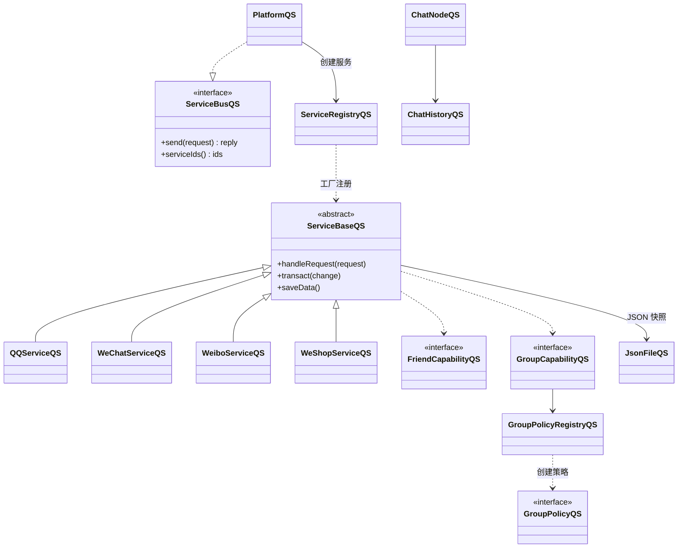
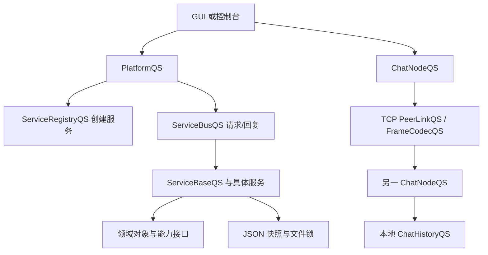

# 架构概览

项目把领域模型、平台协调、服务实现和表现层分开。GUI 与控制台共同链接 `CoreQS`；核心通过请求/回复总线协调服务，而不是让服务直接包含其他服务的实现。边界由 [`ServiceBusQS`](../app/platform/ServiceBusQS.h) 定义，平台由 [`PlatformQS`](../app/platform/PlatformQS.h) 实现。

[`ServiceBaseQS`](../app/platform/ServiceBaseQS.h) 承载通用账号、资料和请求处理；具体服务如 [`QQServiceQS`](../app/services/qq/QQServiceQS.h) 覆写服务标识、账号编号、能力和领域行为。`ServiceRegistryQS` 由静态自注册工厂创建服务，OBJECT 库确保自注册对象进入最终程序。好友能力和群组能力以接口呈现；群策略通过策略注册表按类型创建。

`PlatformQS` 初始化时先建立当前编译进来的服务，再附加各服务数据目录、加载状态并清除登录会话。服务请求经 `ServiceBusQS` 传递，平台记录最多 200 条内存中的请求摘要。GUI/控制台依赖相同核心，因此领域行为由核心统一实现。

### 服务扩展

增加服务的主要入口是 `app/services/<service>/`：服务 `.cpp` 会被 CMake 自动纳入，服务注册工厂发现其静态注册；GUI/控制台适配文件也分别从对应子目录收集。若要裁剪现有服务，构建时使用 `QS_DISABLED_SERVICES`（脚本参数 `-Without`）。这是重新编译时的选择，不支持在运行中加载新模块。

源码定位：[`PlatformQS`](../app/platform/PlatformQS.h)、[`ServiceBaseQS`](../app/platform/ServiceBaseQS.h)、[`ServiceRegistryQS`](../app/platform/ServiceRegistryQS.h)、[`ServiceBusQS`](../app/platform/ServiceBusQS.h)、[`GroupPolicyRegistryQS`](../app/common/GroupPolicyRegistryQS.h)、[`CMakeLists.txt`](../app/CMakeLists.txt)。
